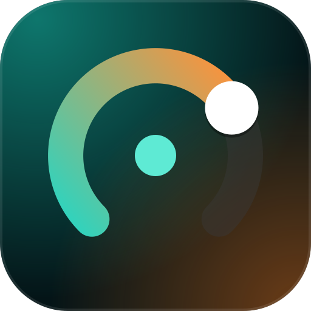

<div align="center">



# ToolKitOSC ESP32

**Let your VRChat avatar switch real things: fans, LEDs, solenoids, relays.**

Firmware for an ESP32 board that [ToolKitOSC](https://github.com/NekoTiki/ToolKitOSC) finds on
your network and drives from your avatar's parameters.

[](LICENSE)


</div>

---

## ✨ Features

### 📡 Finds itself

- Announces itself on your network over **mDNS** (`_tkosc._tcp`), so it shows up in ToolKitOSC
  under **Settings › ESP32 boards** without typing an address.
- First-time **Wi-Fi setup** from your phone: the board opens a `ToolKitOSC-Setup-<id>` network
  with a setup page.
- A stable **board ID** from the chip's MAC address, so the app recognizes the board after an IP
  change, a re-flash or a reset.

### 🔐 Paired to your PC

- Adding a board takes a press of its **BOOT** button, so nobody else on your network can claim it.
- The board only accepts the app holding its pairing token.
- **Unpair or factory reset** without re-flashing: hold BOOT, power-cycle it 5 times, or use the
  serial monitor.

### ⏱️ Outputs that switch themselves off

- The board keeps time itself: every "on" carries a deadline, so pulses stay exact.
- **Pulses, pulse trains, holds and PWM dimming**, with a **max on-time** per output that the app
  can't get around.
- If ToolKitOSC goes quiet for 3 seconds, or the Wi-Fi drops, **everything turns off**.
- Active-low outputs for relay modules, off from the first moment after boot.

### 🧩 Knows its board

- Only offers **pins that are safe to drive**, from the chip, the module (PSRAM, in-package flash)
  and an optional **board profile** with the silkscreen names.
- A **status LED** for pairing, connection and button holds on boards where the LED is known.

---

## 🧱 Repository layout

| Path                  | What it is                                                                   |
| --------------------- | ---------------------------------------------------------------------------- |
| `src/core`            | Protocol, output timing and pin tables. Plain C++, tested on the PC.          |
| `src/platform/esp32`  | Wi-Fi, mDNS, WebSocket, settings storage, BOOT button, status LED and serial. |
| `include`             | Headers. `config.h` holds ports and timings.                                 |
| `test`                | Unity tests for `src/core`.                                                  |
| `PROTOCOL.md`         | The messages between ToolKitOSC and the board.                               |

```text
 VRChat ──OSC──► ToolKitOSC ──WebSocket (JSON)──► ESP32 ──GPIO──► MOSFET / relay ──► fan, LEDs, …
                     ▲                              │
                     └──────── mDNS _tkosc._tcp ────┘
```

---

## 🚀 Getting started

### Prerequisites

- [PlatformIO](https://platformio.org/), as the VS Code extension or `pip install platformio`
- An ESP32, ESP32-S3 or ESP32-C3 board and a USB cable
- A 2.4 GHz Wi-Fi network

### Flash

```bash
git clone git@github.com:NekoTiki/ToolKitOSC-ESP32.git
cd ToolKitOSC-ESP32
pio run -e esp32-s3-devkitc-1 -t upload
pio device monitor
```

Pick the environment for your board:

| Board                                | Environment          | Notes                        |
| ------------------------------------ | -------------------- | ---------------------------- |
| Espressif ESP32-S3-DevKitC-1         | `esp32-s3-devkitc-1` | Default. Port marked "UART". |
| WEMOS LOLIN S3                       | `lolin_s3`           | Port marked "USB".           |
| Seeed XIAO ESP32-S3                  | `seeed_xiao_esp32s3` |                              |
| Seeed XIAO ESP32-C3                  | `seeed_xiao_esp32c3` |                              |
| Other ESP32-C3 boards                | `esp32-c3`           | DevKitM-1, C3 SuperMini, …   |
| Any ESP32 (WROOM-32 / WROVER) board  | `esp32dev`           |                              |

Not sure what you have? `pio device list` shows the port, and
`pio pkg exec -p tool-esptoolpy -- esptool.py --port <port> flash_id` prints the chip, its PSRAM
and its flash size.

If the upload doesn't connect, hold **BOOT**, tap **RST**, let go of BOOT and try again.

> Windows: if the build fails with `xtensa-esp32-elf-g++: error: CreateProcess: No such file or
> directory`, your PlatformIO folder path is too long. Set `PLATFORMIO_CORE_DIR` to a short path
> such as `C:\pio`.

### Connect it to Wi-Fi

On first boot the board opens a Wi-Fi network named `ToolKitOSC-Setup-<id>`. Join it from your
phone or PC and the setup page opens by itself (or go to `http://192.168.4.1`). Choose your
network, give the board a name, and optionally pick a board profile. The board restarts and joins
your network.

### Add it in ToolKitOSC

Open **Settings › ESP32 boards**. The board shows up under **Found on your network**. Click
**Add**, then press the board's **BOOT** button within 30 seconds. On networks where mDNS doesn't
work (VPNs, some guest networks), use **Add by address** with the IP the serial monitor prints.

---

## 🔌 Wiring

An ESP32 pin gives 3.3 V and a few milliamps: enough for one LED, not for a fan, a solenoid or an
LED strip. Switch those through a logic-level MOSFET module or a relay module, powered from their
own supply with a shared ground. Put a flyback diode across motors and solenoids. Relay modules
that switch on when their input is LOW need **active low** turned on for that output in the app.

### Which pins are offered

The firmware only offers pins that are safe to drive, in three layers. Each layer only removes
pins, so a wrong board profile can hide pins but never expose an unsafe one.

1. **Chip** (from the build): strapping, flash, USB, serial and input-only pins are never offered.
2. **Module** (detected at boot): on an ESP32 with PSRAM (WROVER) or in a PICO package,
   GPIO 16 and 17 are taken.
3. **Board profile** (setup page or the `board` serial command): only the pins the board breaks out
   and doesn't already use, with their silkscreen names. `generic` turns it off.

On the ESP32-S3, GPIO 33–37 are never offered: octal flash or PSRAM (as on N16R8 modules) uses
them, and the firmware can't see octal PSRAM it wasn't built for, so it can't tell when they are
free.

The tables are in [`src/core/pins.cpp`](src/core/pins.cpp). Adding a board profile is a few lines
there. Check new tables against the chip's datasheet and the board's schematic.

---

## 💡 Status LED

On boards with a known LED (DevKitC-1, LOLIN S3, XIAO ESP32-S3):

| LED                | Meaning                                 |
| ------------------ | --------------------------------------- |
| Blue, fast blink   | Pairing: press BOOT now                 |
| Green              | ToolKitOSC is connected                 |
| Yellow, slow blink | Not on Wi-Fi                            |
| Orange, slow blink | BOOT held 3 s: let go to unpair         |
| Red                | BOOT held 10 s: let go to factory reset |

---

## ♻️ Resetting without re-flashing

**Unpair** frees the board for another PC and keeps its Wi-Fi. **Factory reset** also forgets the
Wi-Fi, the name and the outputs, and reopens the setup network.

| How                                     | Unpair | Factory reset |
| --------------------------------------- | ------ | ------------- |
| **Remove** in ToolKitOSC (board online) | ✓      |               |
| Hold BOOT while the board is running    | 3 s    | 10 s          |
| Power-cycle 5 times, each under 3 s     |        | ✓             |
| Serial monitor: `unpair` / `reset`      | ✓      | ✓             |

Hold BOOT only once the board is running: held while it powers on, it puts the ESP32 into flashing
mode instead.

If the board loses Wi-Fi for 3 minutes it reopens the setup network, but keeps its pairing.

---

## 🛠️ Development

| Command                          | Description                                    |
| -------------------------------- | ---------------------------------------------- |
| `pio run -e <env>`               | Build for one board                            |
| `pio run -e <env> -t upload`     | Build and flash                                |
| `pio run -e <env> -t erase`      | Erase the whole flash (settings and Wi-Fi too) |
| `pio device monitor`             | Serial monitor at 115200 baud                  |
| `pio test -e native`             | Run the core tests on the PC, no board needed  |

The native tests need a MinGW-w64 GCC on `PATH` on Windows.

Serial commands at 115200 baud: `status`, `pins`, `boards`, `name <text>`, `board <id>`,
`log on|off`, `unpair`, `reset`, `restart`, `help`.

The serial monitor shows what the board is told and what it does:

```text
[cmd] pulse GPIO 4 1000 ms x 2, 500 ms apart    a command from ToolKitOSC
[out] GPIO 4 on                                 a pin really changing
[out] GPIO 4 off
[cmd] set GPIO 4 on 1500 ms
[cmd]   -> refused (max-on)                     why the board didn't do it
```

Holds and dimming resend their command every 500 ms, so `log off` hides the `[cmd]` lines.
`[out]` lines always show.

Libraries: [ArduinoJson](https://arduinojson.org/),
[ESPAsyncWebServer and AsyncTCP](https://github.com/ESP32Async) and
[WiFiManager](https://github.com/tzapu/WiFiManager).

---

## 🤝 Contributing

Issues and pull requests are welcome. Before opening a PR, please run `pio test -e native` and
build at least one board environment, and follow the
[Conventional Commits](https://www.conventionalcommits.org/) style (`feat: …`, `fix(pins): …`).
A change to the messages in [`PROTOCOL.md`](PROTOCOL.md) also bumps `TKOSC_PROTO` in
[`include/config.h`](include/config.h) and needs the matching change in ToolKitOSC.

---

## 📄 License

ToolKitOSC ESP32 is free software: you can redistribute it and/or modify it under the terms of
the **GNU General Public License v3.0 or later**. See [`LICENSE`](LICENSE) for the full text.

This project is not affiliated with or endorsed by VRChat Inc. or Espressif Systems.
